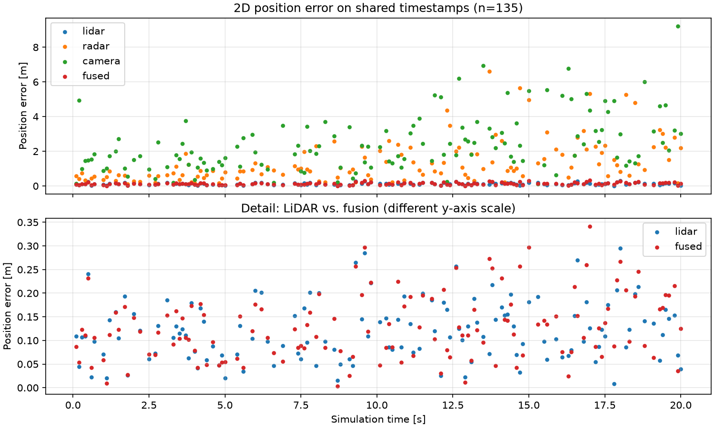

# Multi-Sensor Simulation, Validation & Fusion Framework

A Python portfolio project that simulates LiDAR, Radar, and Camera
measurements for a moving target in 2D. It evaluates each sensor against
synthetic ground truth and compares weighted fusion with individual
sensors on shared timestamps.

For the original project scope, see [PROJECT_BRIEF.md](PROJECT_BRIEF.md).

## Quick Start

Run these commands from the repository root in PowerShell.
The demo was developed with Python 3.13.

```powershell
python -m venv .venv
.\.venv\Scripts\python.exe -m pip install matplotlib pytest

$env:PYTHONPATH = (Resolve-Path .\src).Path
.\.venv\Scripts\python.exe -m examples.run_demo
.\.venv\Scripts\python.exe -m pytest -q
```

The demo prints detection rates, fusion output coverage, and 2D position
RMSE. It also saves the error plot to `docs/images/shared_position_error.png`.

## Example Results

The demo uses a synthetic 20-second scenario, a 0.05 s simulation step,
and fixed random seeds.

| Method | 2D position RMSE on 135 shared timestamps |
|---|---:|
| LiDAR | 0.135 m |
| Radar | 1.839 m |
| Camera | 2.911 m |
| Weighted fusion | 0.145 m |

The fusion pipeline produced a position on **378 of 401 simulation ticks
(94.3%)**, compared with **352 of 401 (87.8%)** for Radar alone.
This includes ticks where only one sensor contributed. On the 135 ticks
where all three sensors detected the target, fusion had lower RMSE than
Radar and Camera, but did not outperform LiDAR.



These results describe one synthetic scenario. The fusion uses fixed
per-sensor position uncertainty settings, not a distance-dependent
uncertainty model.